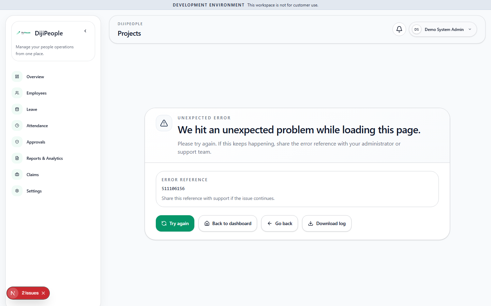
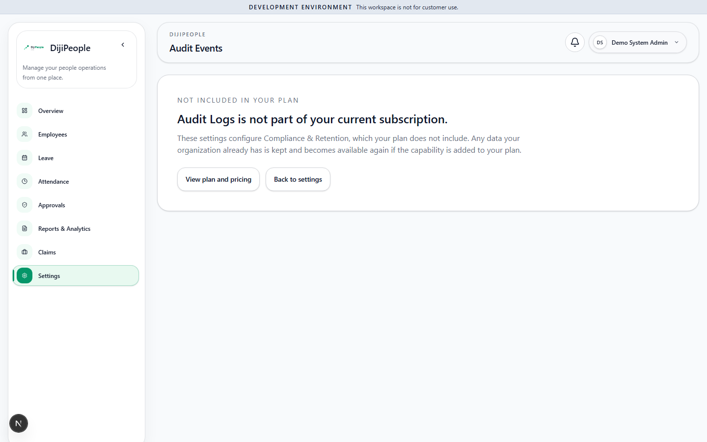

# DP-QA-001 — Non-entitled module routes crash with a generic error instead of the plan-gate screen

| Field | Value |
|---|---|
| Category | Functional / UI-UX (plan enforcement) |
| Severity / Priority | Medium / **P2** |
| Status | Open |
| Module / routes | `/projects`, `/payroll`, `/timesheets`, `/onboarding` (tenant web) |
| Role | Tenant admin (`system-admin`) on a Starter tenant, `entitlementEnforcement = ENFORCE` |
| Test | `DPQA-ENT-1001/1002/1003/1005` |
| Env | local, Chromium, tenant `qa-starter`, commit `214433c1` + QA-only changes, 2026-10-30 |
| Evidence |  · reference of the *correct* behaviour:  |

## Steps
1. Sign in as the tenant admin on a Starter tenant with ENFORCE on.
2. Open `/projects` (or `/payroll`, `/timesheets`, `/onboarding`) directly by URL.

## Expected
The same "Not included in your plan … View plan and pricing" screen that
`/settings/audit-compliance/history/audit-events` already shows — a clear upgrade path.

## Actual
Generic "We hit an unexpected problem while loading this page" with an error reference and a *Download log*
button. Server log: `ApiRequestError: Not included in your plan` (the API correctly answers 403). Console shows
`[DashboardErrorBoundary]`. The user is told something broke, not that the module is a paid feature.

## Analysis
- **CONFIRMED:** API refuses correctly (403, tests `DPQA-ENT-001…005` pass); only the web error handling is wrong.
- **SUSPECTED cause:** module pages do not map the entitlement 403 to the plan-gate component that the Settings
  pages use; it falls to `DashboardErrorBoundary`.
- **Recommended:** reuse the Settings plan-gate component in the shared route error boundary for entitlement 403s.
- Requirement from the brief ("receive correct limits and upgrade messages") is **not met** for these routes.

## Regression impact
Direct-URL / bookmarked links to a module the customer does not own (e.g. after a downgrade) show a crash screen.

## Retest history
| Run | Result |
|---|---|
| RUN-001 | FAIL (reproduced 4/4 routes) |
| RUN-005 (f47e504c) | **RESOLVED** - ENT-1001/1002/1003/1005 pass (Chromium); MCP: /employees/import renders the gate, console clean (`RUN005-MCP-employees-import-plan-gate.png`) |
| RUN-006 (`17d0dcaf`) | **RESOLVED** - ENT-1001: pass, ENT-1002: pass, ENT-1003: pass, ENT-1005: pass |
