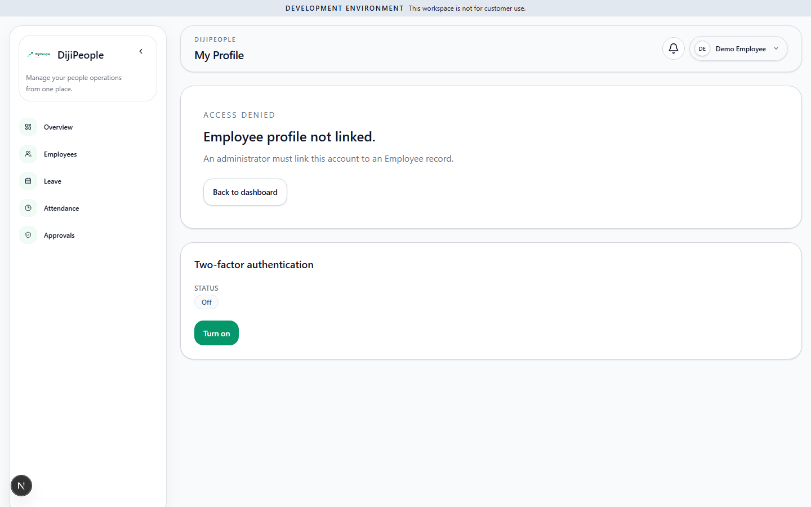
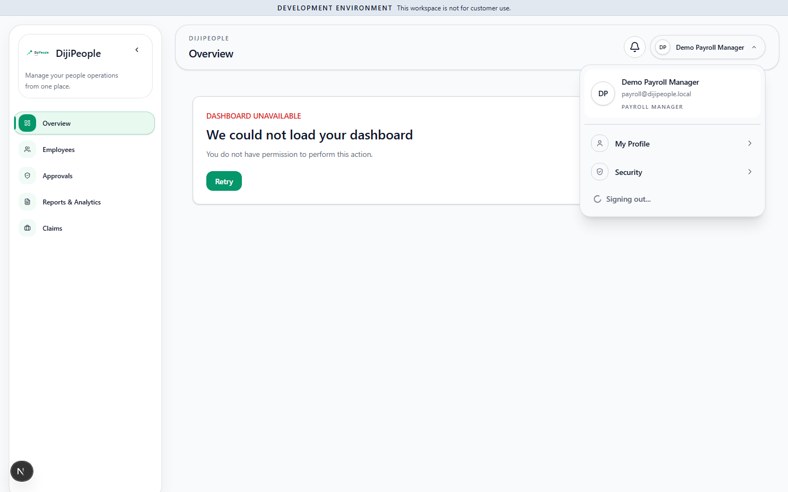

# DP-QA-002 — Non-admin roles get 403 on self-context: "Employee profile not linked" and "We could not load your dashboard"

| Field | Value |
|---|---|
| Category | Functional / Security (RBAC) |
| Severity / Priority | High / **P1 (provisional — pending fixture check below)** |
| Status | Open |
| Module / routes | Overview `/`, `/my-profile`, `GET /api/employees/me/context` |
| Roles | `employee`, `manager`, `hr`, `payroll-manager` (all non-elevated roles tried). `system-admin` works. |
| Tests | `DPQA-SMK-*` as non-admin (to add: `DPQA-RBAC-001..`), probe `probe-api.mjs <ROLE> /employees/me/context` |
| Env | local, Chromium, tenant `qa-starter`, commit `214433c1`, 2026-10-30 |
| Evidence |   |

## Steps
1. Sign in as `employee@…` (linked to employee `DP-ESS`; the Employees list shows that record).
2. Open the profile menu → *My Profile* (or `/my-profile`).
3. Sign in as `payroll@…` and open Overview.

## Expected
Employee sees their own profile; every signed-in user sees an Overview.

## Actual
- `GET /api/employees/me/context` → **403 ACCESS_DENIED** for employee, manager, hr (and payroll). 200 for admin.
- `getCurrentEmployee()` (`apps/web/app/(authenticated)/_lib/current-employee.ts`) converts that 403 into
  `employee: null`, so My Profile says **"Employee profile not linked. An administrator must link this account to an
  Employee record."** — which is false and sends the user to an admin who cannot fix it.
- Payroll role's Overview shows **"We could not load your dashboard — You do not have permission to perform this action."**

## Analysis
- **CONFIRMED:** the 403, the misleading message, and that the DB link exists (`Employee.userId` set for all seven seeded users).
- **CONFIRMED:** the endpoint requires legacy key `dashboard.view`; in the QA database **no role** holds a `dashboard.view`
  `RolePermission` row (hr/manager/employee/payroll all 0), although `BASE_ROLE_PERMISSION_KEYS.hr` lists it.
  The legacy key is bridged from matrix entity `user-preferences` READ (`rbac-matrix.ts` ~L1763) and no
  `SYSTEM_ROLE_PRIVILEGES` entry appears to grant `user-preferences`.
- **SUSPECTED / must verify before the P1 stands:** whether this is (a) a real gap in the system-role matrix that also
  affects production tenants, or (b) an artefact of `seed-demo` role setup. Verification path: provision a tenant
  through the real super-admin provisioning flow (not `seed-demo`) and repeat the probe. Until then the severity is
  provisional; the *misleading message* defect (converting every 403 to "not linked") stands independently as P2.
- **Recommended:** (1) grant `user-preferences` READ to all system roles (or stop gating self-context on it);
  (2) only map a 404/empty result to "not linked", never a 403.

## Regression impact
Self-service (leave, attendance, profile) entry points for every non-admin Starter user. Highest-impact
role-based finding so far; blocks the OWN/TEAM-scope test plan until resolved or fixture-corrected.

## Retest history
| Run | Result |
|---|---|
| RUN-001 | FAIL (reproduced, 4 roles) |
