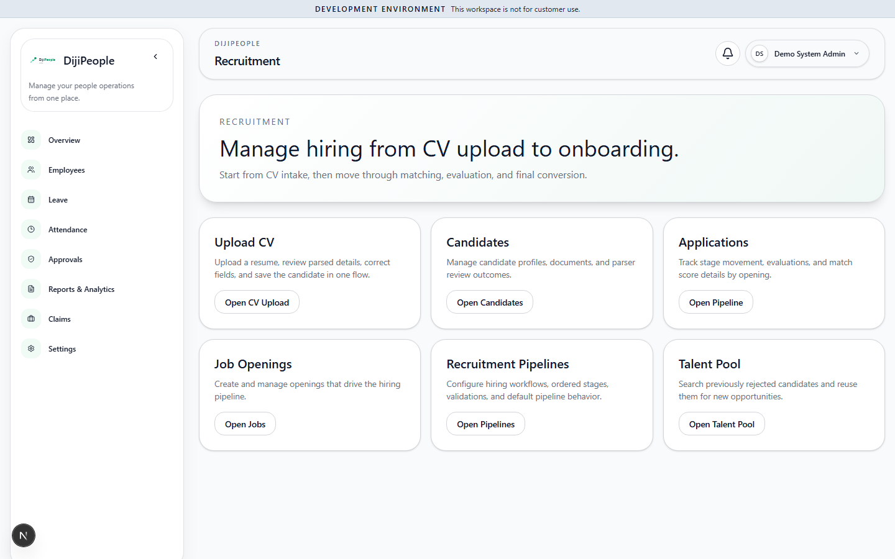

# DP-QA-003 — Recruitment hub renders in full for a Starter tenant under ENFORCE

| Field | Value |
|---|---|
| Category | Functional (plan enforcement, frontend) |
| Severity / Priority | Low / **P3** (API refuses; UI exposure only) |
| Status | Open |
| Route | `/recruitment` |
| Role | Tenant admin, Starter, ENFORCE |
| Test | `DPQA-ENT-1004` |
| Evidence |  |

## Expected / Actual
Expected the plan-gate screen (as for Compliance settings). Actual: the full "Manage hiring from CV upload to onboarding"
hub with *Upload CV / Candidates / Applications / Job Openings / Pipelines / Talent Pool* tiles. `GET /api/job-openings`
is refused (403, test `DPQA-ENT-004` passes), so the sub-pages will fail — the entry page is simply not gated.
Inconsistent with `/projects` etc. (DP-QA-001), which do error.

## Recommended
Gate the hub page server-side the same way as the other modules. Re-check `/onboarding` sub-pages for the same pattern.

## Retest history
| Run | Result |
|---|---|
| RUN-001 | FAIL |
| RUN-005 (f47e504c) | **RESOLVED** - ENT-1004 pass |
