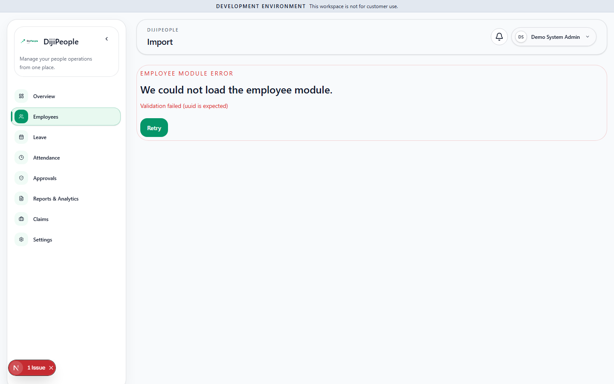

# DP-QA-004 — `/employees/import` fails: "Validation failed (uuid is expected)"

| Field | Value |
|---|---|
| Category | Functional |
| Severity / Priority | Medium / **P2** (bulk import entry point; workaround: *Data Transfer* on the list — **not yet verified**) |
| Status | Open |
| Route | `/employees/import` (link exists in the app: found via sidebar/dashboard link crawl) |
| Role | Tenant admin |
| Test | `DPQA-SMK-004` |
| Evidence |  |

## Actual
Page title "Import" with a red panel "We could not load the employee module. Validation failed (uuid is expected)". Server
log: `ApiRequestError: Validation failed (uuid is expected)` raised from `EmployeeDetailPage`.

## Analysis
- **SUSPECTED:** the path segment `import` is captured by the dynamic `/employees/[id]` route, which passes the literal
  string `import` to `GET /employees/:id` (`ParseUUIDPipe` → 400). The same family as BUG-2461 (`me/…` shadowed by `:employeeId`),
  here on the web route tree. There is no `employees/import` page file in `apps/web/app/(authenticated)/employees/`.
- **Needs verification:** which UI element links to `/employees/import`, and whether *Data Transfer* on `/employees` is the
  intended replacement (then the link is stale).

## Retest history
| Run | Result |
|---|---|
| RUN-001 | FAIL |
