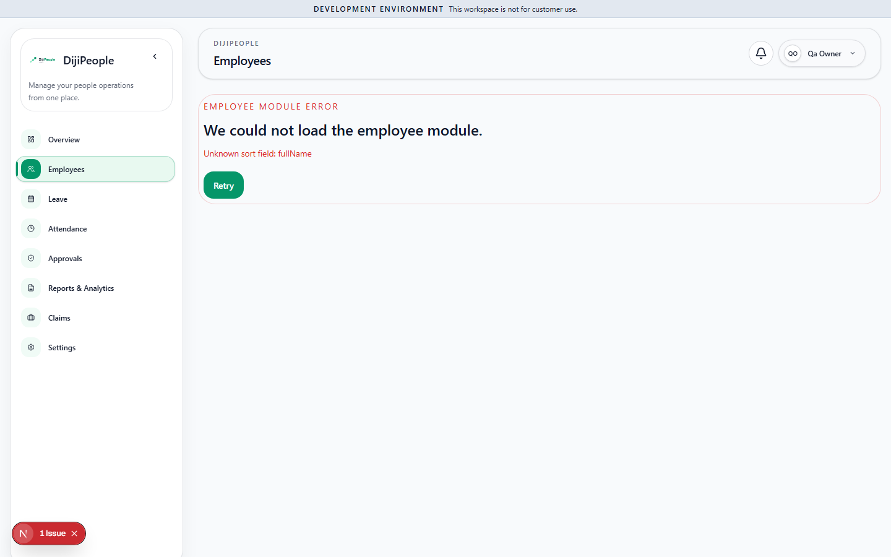

# DP-QA-014 — Employees list: sorting by "Full Name" fails with "Unknown sort field: fullName"

| Field | Value |
|---|---|
| Category | Functional (list command) |
| Severity / Priority | Medium-High / **P2** (a primary Starter screen's sort command breaks the whole list; workaround: other columns / reload without `orderBy`) |
| Status | Open |
| Test | `DPQA-EMP-008` (fails); `DPQA-EMP-009` covers Employee Code |
| Env | tenant `qa-prov-a`, owner, Chromium, `USE_ENTITY_DATA_API=true` |
| Evidence |  |

## Steps
1. Open `/employees`. 2. Click the sort control on the *Full Name* column header.

## Expected / Actual
Expected rows re-ordered. Actual: URL becomes `/employees?viewId=…&orderBy=fullName+desc&page=1` and the page is replaced by
"EMPLOYEE MODULE ERROR — We could not load the employee module. **Unknown sort field: fullName**" with a Retry button (Retry keeps the bad URL).

## Analysis
- **CONFIRMED:** the legacy endpoint accepts the same ordering: `GET /api/employees?orderBy=fullName desc` → 200 (probe). The failing path is the generic
  entity data API used when `USE_ENTITY_DATA_API=true` (see memory *employee-list-has-two-data-paths*), which does not know the computed `fullName` column.
- Likely every computed/virtual column in the metadata view has the same trap — sweep all column sorts per module.
- Production is believed to run `USE_ENTITY_DATA_API=true` (env examples); **verify** before ranking down.

| Run | Result |
|---|---|
| RUN-002 | FAIL |
| RUN-005 (f47e504c) | **RESOLVED** - EMP-008 pass |
| RUN-006 (`17d0dcaf`) | **RESOLVED** - EMP-008: pass |
