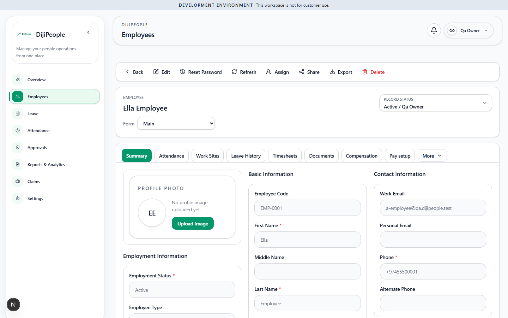

# DP-QA-015 — Starter tenant's employee record exposes tabs for Timesheets, Compensation, Pay setup, Payslips and Project Allocations

| Field | Value |
|---|---|
| Category | Functional (plan enforcement, frontend) |
| Severity / Priority | Medium / **P2** |
| Status | Open |
| Test | `DPQA-EMP-007` (fails) |
| Env | `qa-prov-a` (Starter, ENFORCE), owner |
| Evidence |  |

## Actual (CONFIRMED)
`/employees/{id}` renders `role=tab` entries: Summary, Attendance, Work Sites, Leave History, **Timesheets**, Documents, **Compensation**, **Pay setup**; and further
Banking Details, **Payslips**, **Project Allocations**, Previous Employment, Employee History, Education, Agent in the overflow list. Payroll, Timesheets and
Projects are not Starter features; their API routes return 403 under ENFORCE (DPQA-ENT-001…005), so these tabs lead to empty or failing panes. The dashboard tile
"Pending process items — Leave, payroll, and timesheet work" has the same problem (OBS-004).

## Recommended
Hide tabs whose owning feature is not enabled for the tenant (the sidebar already does this correctly). Banking details is HR/payroll-sensitive: confirm it is
not reachable by a Starter tenant either.

| Run | Result |
|---|---|
| RUN-002 | FAIL |
| RUN-005 (f47e504c) | **RESOLVED** - EMP-007 pass; MCP My Profile shows Summary, Attendance, Leave History, Documents, Previous Employment, Employee History, Education - no Timesheets/Payslips/Project Allocations |
| RUN-006 (`17d0dcaf`) | **RESOLVED** - EMP-007: pass |
