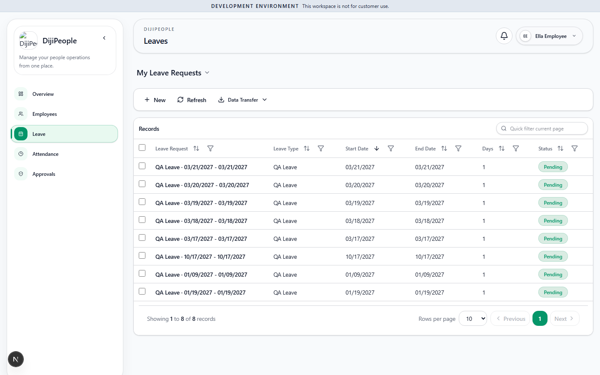

# DP-QA-016 — A branding logo uploaded by an admin is a broken image (404) for every non-admin user

| Field | Value |
|---|---|
| Category | Functional (Branding — a Starter feature) |
| Severity / Priority | Medium / **P2** |
| Status | Open |
| Test | `DPQA-LV-010` (fails on the console error); reproduction `ui-probe.cjs A EMPLOYEE /leaves` |
| Env | `qa-prov-a`, role employee (also HR), 2026-10-30 |
| Evidence |  — top-left shows the alt text "DijiPe…" instead of the logo |

## Actual (CONFIRMED)
After the owner sets a logo (`logoUrl: /api/documents/<id>/view`, PNG), `GET /api/documents/<id>/view` returns **200 image/png for the owner** and
**404 application/json for employee and HR**. Every non-admin page then logs `404 …/api/documents/<id>/view` and shows a broken image in the sidebar header.

## Analysis
The logo is stored as an ordinary document and served through the document authorization path, which denies roles without documents access. Tenant branding
assets must be readable by every authenticated user of the tenant (and by the login page for the public brand). Fix: serve branding assets through a branding-specific route or mark them tenant-public.

| Run | Result |
|---|---|
| RUN-002 | FAIL |
| RUN-005 (f47e504c) | **RESOLVED** - BRAND-002: logo loads for owner, employee, HR, manager and payroll-manager; tenant B never receives A's asset |
| RUN-006 (`17d0dcaf`) | **RESOLVED** - BRAND-002: pass |
