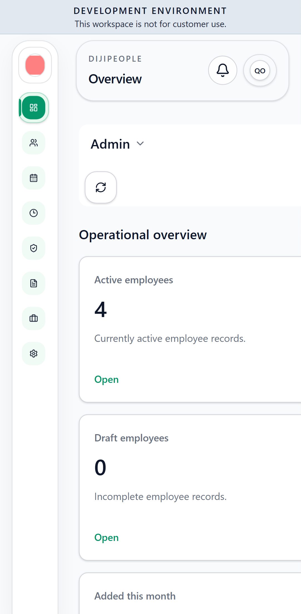

# DP-QA-017 — Overview page overflows horizontally on a 412 px phone (page scrollWidth 501 px)

| Field | Value |
|---|---|
| Category | UI/UX (responsive) |
| Severity / Priority | Medium / **P2** |
| Status | Open |
| Test | `DPQA-RESP-001` — project `mobile` (Pixel 7, 412 px). Tablet (iPad gen 7) passes. |
| Evidence |  |

The dashboard's content is 89 px wider than the viewport, producing a horizontal page scroll on phones. Employees, New Employee, Leave, Attendance and Settings did not overflow
(RESP-002…006 pass). **SUSPECTED:** a fixed-width tile/grid row on the Overview ("Workforce distribution" bars or the stats grid). Not traced to a selector.

| Run | Result |
|---|---|
| RUN-002 | FAIL (mobile) |
| RUN-005 (f47e504c) | **RESOLVED** - RESP-001 pass on Chromium, mobile (Pixel 7) and tablet |
