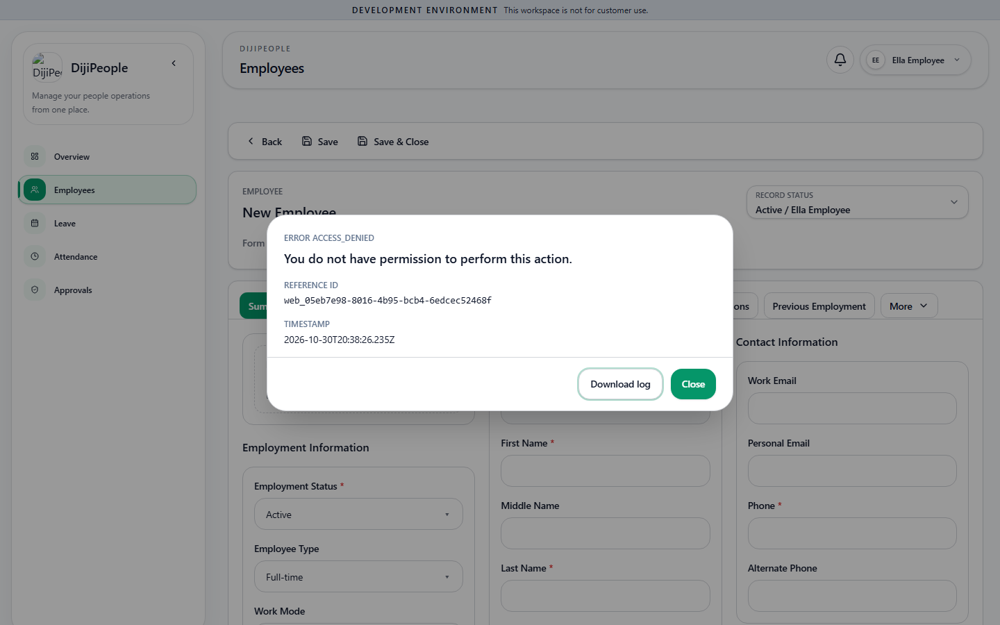

# DP-QA-021 — The New Employee form (with a Save button) is rendered to an employee-level user

| Field | Value |
|---|---|
| Category | Functional / UX (UI gating; the API correctly refuses) |
| Severity / Priority | Low / **P3** |
| Status | Open |
| Test | `DPQA-CMD-011` (fails); API `DPQA-ORG-005` / `DPQA-ISO-005` show creation is refused server-side |

An employee who navigates to `/employees/new` gets the full form including **Save**; the list screen correctly offers no *New* command (`DPQA-CMD-010`). The refusal comes only on submit (403). Guard the route (redirect or access-denied screen) so the user is not invited to fill in a form they cannot save.

| Run | Result |
|---|---|
| RUN-003 | FAIL |

Evidence: 

## Retest history (RUN-005)

| Run | Result |
|---|---|
| RUN-005 (f47e504c) | **RESOLVED** - CMD-011 pass |
| RUN-006 (`17d0dcaf`) | **RESOLVED** - CMD-011: pass |
