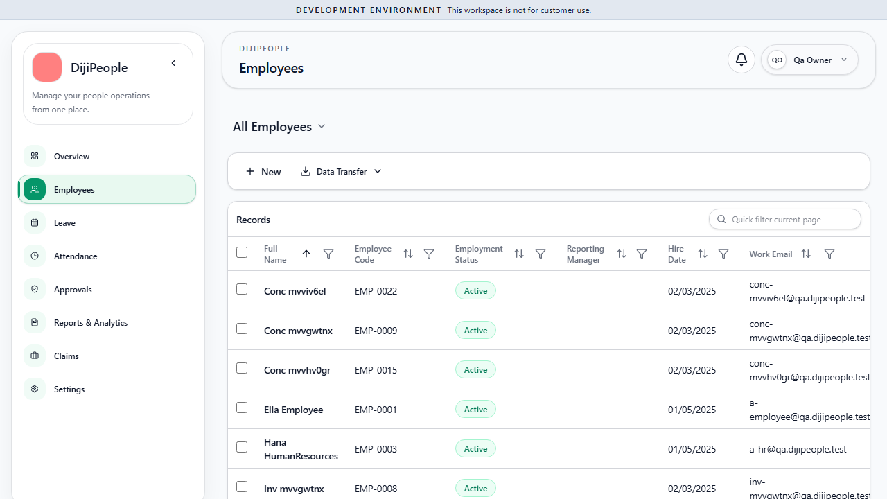

# DP-QA-030 — Soft-deleted employees are still listed (as Active) on the web Employees screen

| Field | Value |
|---|---|
| Category | Functional / data visibility (privacy) |
| Severity / Priority | High / **P1** — deleted people's records remain visible to everyone who can open the list |
| Status | Open |
| Test | `DPQA-EMP-010` (fails) |
| Evidence |  — rows "Conc …" (EMP-0022, EMP-0009, EMP-0015) are deleted in the database |

## Facts (CONFIRMED)
- Database: the "Conc …", "Inv …", "Race …", "Onb …" fixture employees all have `isDeleted = true` with `deletedAt` set (rows EMP-0009/0015/0022 in the screenshot among them).
- API: `GET /api/employees` (legacy path) **excludes** them.
- Web: `/employees` (entity data API, `USE_ENTITY_DATA_API=true`) **lists them as Active** with e-mail address and employee code.
This is the second divergence between the two list data paths (cf. [[DP-QA-014]]). Also check reports, exports, search, the quick filter and the Overview "Active employees" tile for the same leak.

| Run | Result |
|---|---|
| RUN-004 | FAIL |
