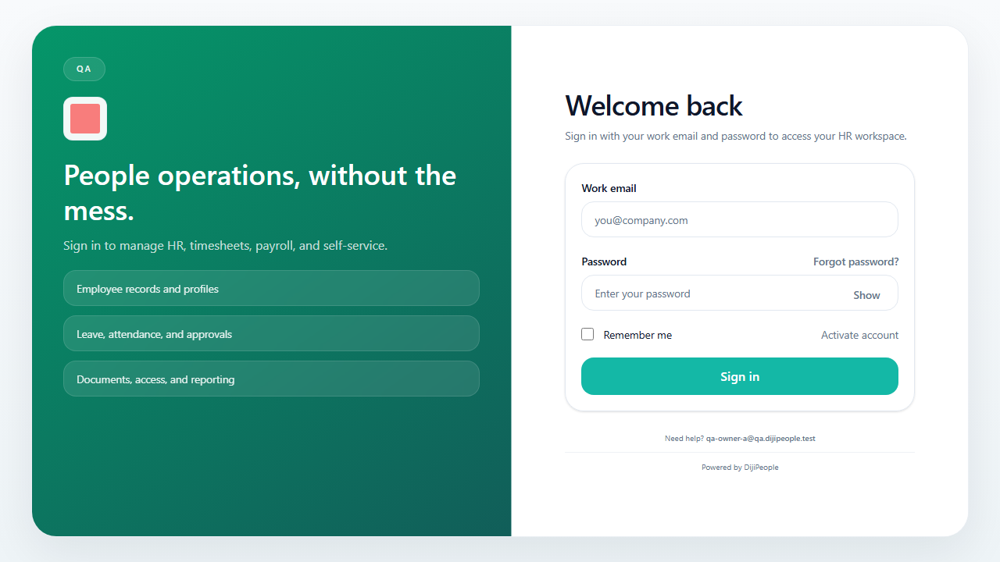

# DP-QA-032 — The "Activate account" button does not submit when clicked (pressing Enter does)

| Field | Value |
|---|---|
| Category | Functional / UX — first-use onboarding |
| Severity / Priority | High / **P2** (a workaround exists but a new user will not find it) |
| Status | Open |
| Tests | `DPQA-INV-104` (click, fails), `DPQA-INV-106` (Enter, passes) |
| Evidence |  — the green button is cut off at the bottom edge at 1280×720 |

On `/activate-account?token=…` both passwords are valid ("Met: …", "Passwords match") but clicking **Activate account** produces **no request** (no console error, no alert). Pressing Enter in a password field posts `/api/auth/activate-account` → 201 → redirect to `/login`, and the new password signs in.
A programmatic click at the button's coordinates hits the `<form>` element instead of the button (`elementFromPoint` = FORM): the button is not hit-testable where it is drawn at 1280×720 on the production build. **SUSPECTED:** layout/overlay or `overflow` clipping at the bottom of the page; reproduce at other viewport heights before fixing.

| Run | Result |
|---|---|
| RUN-004 | FAIL (click), PASS (Enter) |
| RUN-005 (f47e504c) | **RESOLVED** - INV-104 (click) and INV-106 (Enter) pass |
