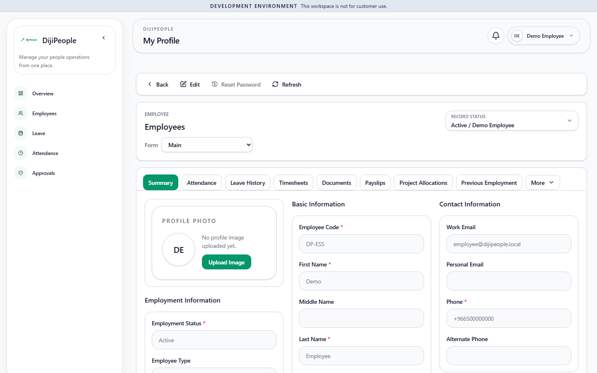

# DP-QA-034 — "My Profile" lookups answer 403 for an employee (Team, Location, Official Joining Location, Work Schedule)

| Field | Value |
|---|---|
| Category | Functional / RBAC (self-service) — the next layer of [[DP-QA-002]] |
| Severity / Priority | Medium / **P2** |
| Status | Open |
| Evidence | probe `explore.mjs EMPLOYEE /my-profile` (candidate): `403 /api/teams?departmentId=…&teamType=ORGANIZATIONAL`, `403 /api/locations?isActive=true`, console `Runtime lookup hydration failed {field: teamId, message: You do not have permission to perform this action.}` ; screenshot  |

After the DP-QA-002 fix the employee's profile page **loads** (Employee code, name, work e-mail, phone, status). The reference lists that populate the lookup fields (Team, Location, Official Joining Location, Default Work Schedule) are fetched from admin-scoped endpoints, which an employee may not read, so those fields cannot be displayed (blank or raw ids) and each page view logs hydration errors. An employee must be able to see *their own* team/location by name without being able to list all teams/locations.
Related: the profile page also offers the tabs Timesheets, Payslips and Project Allocations — see [[DP-QA-015]] (reopened).

| Run | Result |
|---|---|
| RUN-004 | FAIL |
